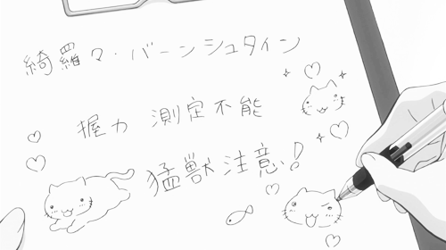

  

 

<pre>
  Name       Hell4uk
  Role       Full-Stack Developer
  Interests  Software · Backend · Systems · Frontend · B2b · AI/ML
</pre>

 

  

 

## Tech Stack

**Languages**

  

**Frontend**

  

**Backend**

  
   
  

**Databases & Messaging**

  

**Infrastructure & Tools**

  

---

  
  

